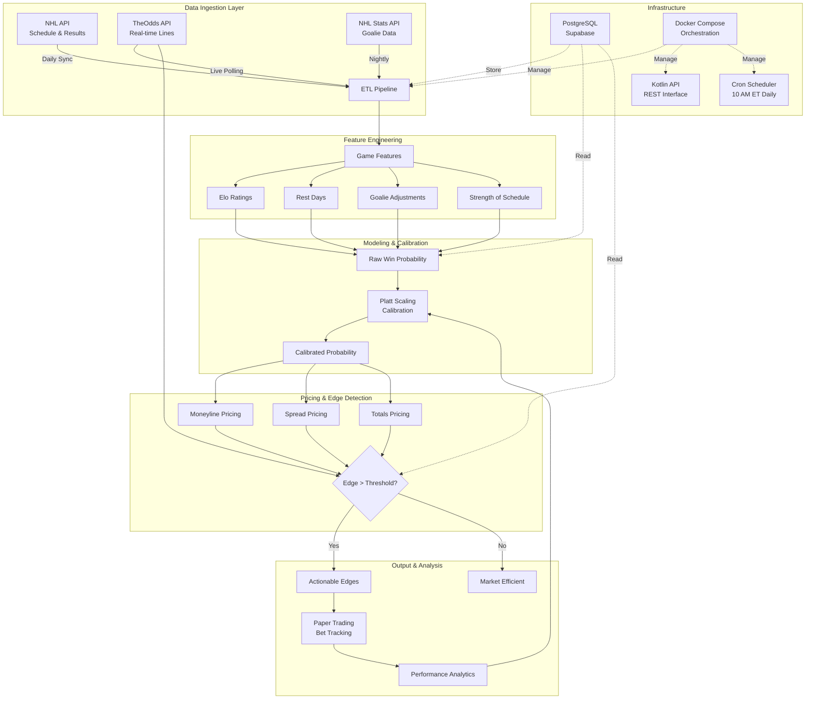

# NHL Game Pricing & Market Analytics Pipeline

A full-stack sports analytics platform for NHL game outcome modeling, market pricing analysis, and edge detection. This system ingests game schedules, results, and real-time odds from multiple sportsbooks, computes Elo-based win probabilities enhanced with advanced features (rest days, goalie matchups, strength-of-schedule adjustments), calibrates predictions using Platt scaling, and identifies pricing inefficiencies across moneyline, spread, and totals markets.

## 🏗️ Architecture



## 🚀 Tech Stack

### Backend & Data Pipeline
- **Python 3.11+** - Core ETL and modeling logic
- **PostgreSQL (Supabase)** - Primary data warehouse with 40+ Flyway migrations
- **psycopg3** - Modern async PostgreSQL driver
- **pandas & numpy** - Data manipulation and numerical computing
- **scipy** - Statistical modeling (Normal distribution for totals, calibration)

### Modeling & ML
- **Custom Elo Rating System** - Team strength estimation with K-factor tuning
- **Platt Scaling** - Logistic calibration for probability outputs
- **Feature Engineering** - Rest days, goalie GAA, head-to-head, strength-of-schedule
- **Backtesting Framework** - Historical validation with time-series cross-validation

### Data Sources
- **NHL API** - Official schedule, results, and team data
- **TheOdds API** - Real-time odds from DraftKings, FanDuel, BetMGM
- **NHL Stats API** - Goalie statistics and player data

### Infrastructure
- **Docker & Docker Compose** - Containerized deployment
- **Kotlin + Spring Boot** - REST API for data access (Gradle build)
- **Flyway** - Database schema versioning and migrations
- **Cron** - Automated daily pipeline execution (10 AM ET)

### Development
- **Git** - Version control
- **pytest** - Unit and integration testing
- **Jupyter** - Exploratory analysis notebooks

## 📊 Sample Output

### Edge Detection
```
[2026-10-17 10:15:23] Processing 12 upcoming games...

Game 2026020120 (BOS @ ANA)
├─ Predicted Win Probability: 57.3% (calibrated)
├─ Market Pricing:
│  ├─ DraftKings: BOS -155 (60.8% implied) → Edge: -3.5%
│  ├─ FanDuel:    BOS -148 (59.7% implied) → Edge: -2.4%
│  └─ BetMGM:     BOS -142 (58.7% implied) → Edge: -1.4%
└─ Result: No actionable edge (market efficient)

Game 2026020119 (PIT @ COL)
├─ Totals Prediction: 6.71 goals (±2.29 std dev)
├─ Market Lines:
│  ├─ DraftKings: O6.5 -118 (54.1% implied) → Over Edge: -0.4%
│  ├─ BetMGM:     O6.0 -118 (54.1% implied) → Over Edge: +5.5% ✓
│  └─ FanDuel:    O6.5 -122 (55.0% implied) → Over Edge: -1.3%
└─ ✓ ACTIONABLE: BetMGM Over 6.0 (+5.5% edge, 57.1% win prob)

Summary: 1 actionable edge found across 36 market combinations
```

### Calibration Report
```
Platt Scaling Calibration (2025-26 Season Bets)
═══════════════════════════════════════════════
Sample: 218 bets (174 train, 44 test)

Calibration Parameters:
  a (slope):     -0.2067
  b (intercept): -0.3363

Performance:
  Before: 23.72% calibration error
  After:   2.60% calibration error
  Improvement: 89.0%

Probability Bucket Analysis:
  50-55%: Predicted 52.1% → Actual 51.8% (n=45) ✓
  55-60%: Predicted 57.3% → Actual 56.9% (n=38) ✓
  60-65%: Predicted 62.1% → Actual 58.3% (n=21) ⚠ Slight overconfidence
```

## 🛠️ Setup & Installation

### Prerequisites
- **Docker & Docker Compose** (for local development)
- **Python 3.11+** (for pipeline scripts)
- **TheOdds API Key** ([free tier available](https://the-odds-api.com/))
- **Supabase Account** (or local PostgreSQL)

### Quick Start

1. **Clone the repository**
   ```bash
   git clone https://github.com/Natan-Coder/nhl-analytics-pipeline.git
   cd nhl-analytics-pipeline
   ```

2. **Set up environment variables**
   ```bash
   # Create pipelines .env
   cp pipelines/.env.example pipelines/.env

   # Edit pipelines/.env with your credentials:
   # - DATABASE_URL (Supabase connection string)
   # - THEODDS_API_KEY (from the-odds-api.com)

   # Create shared config .env
   cp shared/config/.env.example shared/config/.env
   # Edit shared/config/.env with your database credentials
   ```

3. **Install Python dependencies**
   ```bash
   cd pipelines
   python -m venv .venv
   source .venv/bin/activate  # On Windows: .venv\Scripts\activate
   pip install -r requirements.txt
   ```

4. **Run database migrations**
   ```bash
   # Using Docker (local Postgres):
   cd infra/docker
   docker-compose up flyway

   # Or manually with Flyway CLI pointing to your Supabase instance
   ```

5. **Run the pipeline**
   ```bash
   # From project root
   cd pipelines

   # Ingest schedule and results
   python -m etl.ingest_schedule
   python -m etl.ingest_results

   # Compute Elo ratings
   python -m pricing.compute_team_elos

   # Fetch current odds
   python -m etl.ingest_odds_theoddsapi

   # Compute edges
   python -m pricing.compute_edges
   python -m pricing.compute_totals_edges

   # View actionable bets
   python -m betting.preview_edges
   ```

### Docker Deployment (Automated Daily Runs)

```bash
# Builds and runs the full stack (Postgres, Flyway, Pipeline Runner, API)
cd infra/docker
docker-compose up -d

# Pipeline runs automatically at 10 AM ET via cron
# View logs:
docker logs nhl_betting_automation -f
```

## 📈 Project Roadmap

### ✅ Phase 1: Core Pipeline (Complete)
- [x] NHL schedule and results ingestion
- [x] Elo rating system with home-ice advantage
- [x] Platt scaling calibration
- [x] Moneyline pricing and edge detection
- [x] Paper trading bet tracking
- [x] Docker containerization with cron automation

### ✅ Phase 2: Advanced Features (Complete)
- [x] Goalie GAA adjustments
- [x] Rest days feature engineering
- [x] Totals (over/under) pricing model
- [x] Spread (puckline) support
- [x] Multi-book edge comparison

### 🔄 Phase 3: Model Refinement (In Progress)
- [x] Historical backtesting framework
- [ ] Platt scaling for totals market
- [ ] Feature importance analysis
- [ ] Ensemble model exploration (XGBoost, LightGBM)
- [ ] Moving K-factor for Elo (adaptive learning rate)

### 📋 Phase 4: Infrastructure & Visualization (Planned)
- [ ] Materialized view refreshes for real-time API
- [ ] FastAPI REST endpoints for live edges
- [ ] React dashboard for bet tracking and analytics
- [ ] Automated performance reporting (weekly email digests)
- [ ] GitHub Actions CI/CD pipeline

### 🔬 Phase 5: Research Opportunities (Backlog)
- [ ] Player prop modeling (shots, goals, assists)
- [ ] Live in-game betting (requires real-time data source)
- [ ] Alternative data sources (injuries, weather for outdoor games)
- [ ] Market maker simulation (offer synthetic lines)

## 📁 Project Structure

```
nhl-analytics-pipeline/
├── backend-api/              # Kotlin Spring Boot REST API
│   ├── src/main/kotlin/     # API controllers and services
│   └── src/main/resources/  # Application configs
├── infra/
│   ├── db/migrations/       # Flyway SQL migrations (V1-V42)
│   └── docker/              # docker-compose orchestration
├── pipelines/               # Python data pipeline (main codebase)
│   ├── etl/                # Data ingestion (schedule, results, odds)
│   ├── pricing/            # Game pricing, Elo, edge computation
│   ├── betting/            # Bet selection and tracking
│   ├── analysis/           # Model training, backtesting, calibration
│   ├── features/           # Feature engineering logic
│   └── common/             # Shared utilities and logging
├── docs/                   # Architecture diagrams and analysis
└── README.md               # You are here
```

## 🧪 Testing & Validation

### Model Backtesting
```bash
# Test moneyline model on 2025-26 season
python -m analysis.train_platt_scaling

# Backtest totals predictions
python -m analysis.backtest_totals

# Compare calibration methods
python -m analysis.compare_calibrations
```

### Data Quality Checks
```bash
# Verify Elo rating continuity
python -m analysis.replay_elos

# Check goalie coverage
python -m analysis.diagnose_goalie_coverage

# Validate rest days calculation
python -m analysis.diagnose_rest_days_coverage
```

## 📊 Database Schema Highlights

- **`game_results`** - Historical NHL games with scores (20K+ rows)
- **`team_elos`** - Time-series Elo ratings per team (5K+ snapshots)
- **`game_features`** - Engineered features (rest days, goalies, strength-of-schedule)
- **`odds_quotes`** - Live sportsbook lines across markets (100K+ quotes)
- **`edges`** - Computed market edges with Kelly criterion sizing
- **`bets`** - Paper trading ledger with outcomes
- **`calibration_params`** - Platt scaling coefficients (a, b parameters)

## 🤝 Contributing

This is a personal portfolio project, but I'm open to collaboration! If you have ideas for:
- Alternative modeling approaches
- Additional data sources
- Feature engineering improvements
- Infrastructure optimizations

Feel free to open an issue or submit a pull request.

## 📌 Note on Model Parameters

While this codebase is open-source for educational and portfolio purposes, certain tuned parameters (Elo K-factors, Platt scaling coefficients, feature weights, etc.) in production use may differ from those committed to this repository. The methodology, architecture, and implementation approach are fully transparent to demonstrate data engineering and modeling capabilities.

## ⚖️ Disclaimer

This project is for **educational and analytical purposes only**. It demonstrates:
- Data pipeline engineering
- Statistical modeling and calibration
- Market efficiency analysis
- Sports analytics

It is **not financial advice** and should not be used for actual wagering without understanding the risks. Sports betting involves substantial financial risk. Past performance does not guarantee future results.

## 📄 License

MIT License - See [LICENSE](LICENSE) for details.

## 🙏 Acknowledgments

- **NHL API** - Official game data
- **TheOdds API** - Comprehensive odds coverage
- **Supabase** - Managed PostgreSQL hosting
- **Flyway** - Database migration tooling

---

**Built with** 🏒 **by [Natan Coder](https://github.com/Natan-Coder)**

*Exploring the intersection of sports analytics, statistical modeling, and market efficiency*
